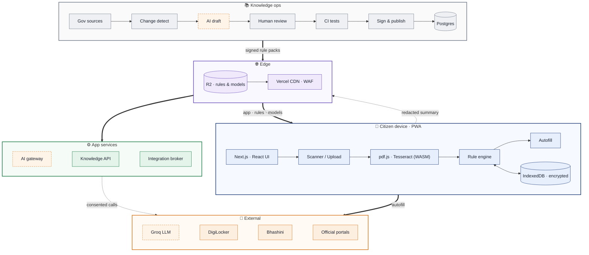

# RejectLess — System Architecture

Rendered: [architecture-mermaid.png](architecture-mermaid.png) · Detailed version: [architecture.png](architecture.png) / [index.html](index.html)

Regenerate the PNG by opening `mermaid.html` (headless Chrome with `--allow-file-access-from-files`), or paste `architecture.mmd` into https://mermaid.live.
